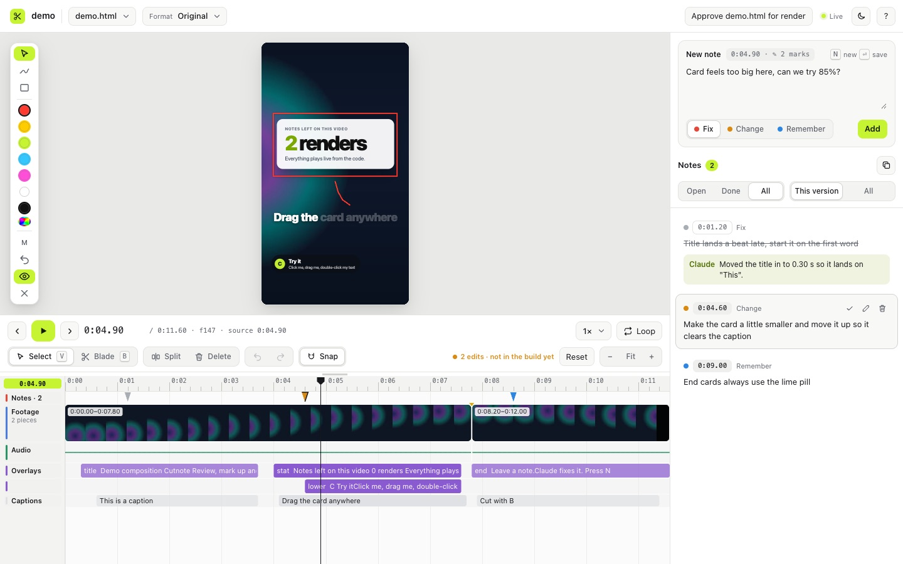
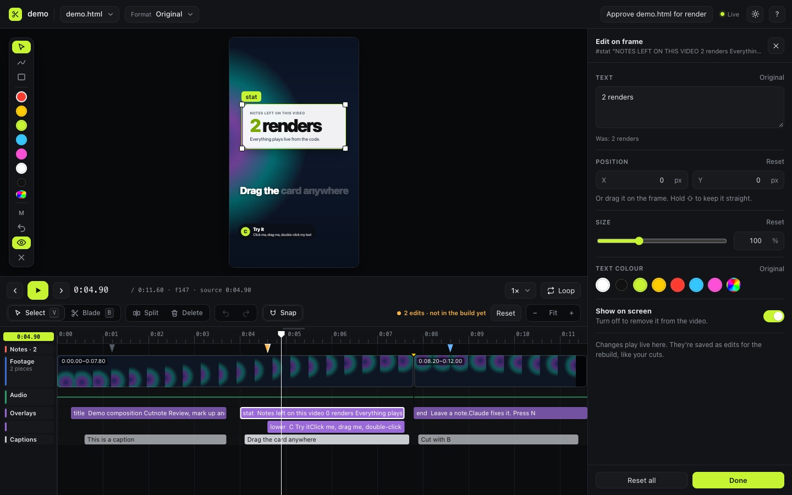

# Cutnote

**Review, mark up and cut videos in your browser, then hand the notes to Claude.**

[Website](https://jackd0127-dev.github.io/cutnote/) · [Install](#install) · [Try the demo](#try-the-demo) · [Keyboard](#keyboard)



Cutnote is a small local video review player and editor. Open a folder, and it plays your videos and [HyperFrames](https://www.npmjs.com/package/hyperframes) compositions live, with no render step. You pause anywhere, write a note, draw on the frame, and cut the footage on a timeline. Everything is saved as plain files that an AI assistant such as Claude Code (or a human editor) can read and act on.

It runs on your machine and needs no account or upload. It is one Python file plus one page, and has no dependencies beyond Python and ffmpeg.

## What it does

- **Live review.** Plays HyperFrames compositions straight from their HTML and reloads by itself when the file is rebuilt, keeping your place. Also plays `.mp4`, `.mov`, `.m4v` and `.webm` files.
- **Timestamped notes.** Press <kbd>N</kbd>, type, press <kbd>Enter</kbd>. Notes are tagged *Fix*, *Change* or *Remember*, can cover an in/out range, and record what was on screen at that moment. They land in `review-notes.md` and `review-notes.json`.
- **Draw on any frame.** Scribble and box tools, any colour and three line widths. Marks can be selected, moved, resized and deleted. Each drawing is saved as a PNG next to the notes.
- **A real timeline.**
  - Tools: Select <kbd>V</kbd>, Slip <kbd>Y</kbd> (show a different moment of a piece, same length and place), Roll <kbd>T</kbd> (move a cut between two pieces), Blade <kbd>B</kbd>.
  - Split at the playhead: <kbd>⌘B</kbd>. Trim start / trim end to the playhead: <kbd>Q</kbd> / <kbd>W</kbd>. Ripple delete: <kbd>⌫</kbd>.
  - **Speed:** select a footage piece or b-roll clip and pick a speed, from 0.25× slow motion to 4×. It plays at that speed and the timeline shows its new length.
  - Drag pieces to reorder them, drag their edges to trim. Move and trim overlays, captions and sound.
  - Every track header has an eye to hide the track and a speaker to mute it.
  - Timeline settings: snapping, magnetic timeline (clips stay stuck to the footage when you cut it, or keep their place in time), loop playback (the in/out range or the whole video), follow the playhead, filmstrip.
  - Undo and redo, zoom, and a filmstrip and waveform for the main footage.
- **Sound effects.** The **Sounds** tab has 50 original sound effects (whooshes, pops, clicks, UI dings, impacts, risers, glitches, cartoon, money, camera), all synthesized by `library/sfx/make_sfx.py`, so they're free to use. Click one to hear it, drag it onto the timeline or press **+** to add it at the playhead. Sounds sit on their own **Sound FX** track with a waveform: drag to move, pull an edge to trim, set the volume. They play live, **Export cut** mixes them in, and your AI assistant adds them to compositions.
- **Edit what's on screen.** With the Select tool, click any overlay, card or caption on the frame. A sidebar opens where you can:
  - change its text (word-by-word animation keeps working)
  - set its position and size, or drag it on the frame and pull a corner
  - change the text colour
  - hide it

  Changes update live and are saved as edits for whoever builds the composition.
- **Layers.** Drag overlays, b-roll, captions and sounds up or down on the timeline to move them to another row. The top row plays in front.
- **Formats.** Reframe for 9:16, 4:5, 1:1, 16:9 or 4:3. Drag a crop window over the frame to choose what stays in the shot.
- **Export cut.** For plain video files, Cutnote renders your cut, speed changes, sound effects, mutes and reframe with ffmpeg as a new file next to the original: `name (edited).mp4`. It never overwrites anything.
- **Component library.** The sidebar has four tabs: **Notes**, **Library**, **Captions** and **Sounds**. Library holds animated overlays (stat tiles, kinetic type, a customer crowd, before/after cards, price sliders, break-even graphs, storylines, series cards and more), grouped into collections you switch with a dropdown. Every card loops a live preview. Drag one onto the video or the timeline and it's added at once: it plays on the video at that moment inside a neon outline, and a neon block on the timeline's **Library** lane shows how long it plays. Drag the block to retime it, pull its right edge to change the length, or drag the outline's chip to move it on the frame. Each one is saved as a note, so your AI assistant builds it properly on the next run.
- **Caption styles.** The Captions tab lists caption styles (classic, highlight, one word, boxed, typewriter…). Drop one on the video and it applies to the whole video, marked in magenta across the timeline.
- **Cutnote Hub.** Hover **Cutnote Editor** at the top left and pick **Cutnote Hub**: a project manager with every video project on your computer, each with a picture, open notes and when it was last edited. Open one to switch to it, rename it (only the name shown changes, never the folder), remove it from the list or move its folder to the Trash, and make a new project (drop footage in and it's copied into a fresh folder). Tell it which folders to watch and projects in them appear by themselves. The first time you open it, a short tour shows you round (skip it any time, or replay it from **Take the tour**). AI assistants add the projects they make with `review.py --add`. Everything is saved on your computer in `~/.config/cutnote/projects.json`.
- **Updates.** A version chip in the header turns lime when a new Cutnote is out. **Update now** installs it and restarts in place, or switch on **Update automatically**.
- **Approval gate.** For compositions, an *Approve* button records the exact build you signed off. A render script can refuse anything that isn't approved.
- **Light mode by default, dark mode with <kbd>⇧D</kbd>**, custom dropdowns, and editor-standard shortcuts. Press <kbd>?</kbd> in the app for the full list.

## Install

### With Claude Code (easiest)

Paste this into Claude Code:

```text
Install Cutnote from https://github.com/Jackd0127-dev/cutnote (follow its AGENTS.md), then open it on the folder with my video.
```

Claude clones the repo, checks for Python and ffmpeg, starts Cutnote and gives you the link. When you've left notes, say *"I've left notes"*. Claude reads `review-notes.md`, makes the changes and marks each note done with a reply. The player updates live.

### One command

macOS and Linux:

```bash
curl -fsSL https://raw.githubusercontent.com/Jackd0127-dev/cutnote/main/install.sh | sh
```

Windows (PowerShell):

```powershell
irm https://raw.githubusercontent.com/Jackd0127-dev/cutnote/main/install.ps1 | iex
```

The setup checks for everything Cutnote uses and offers to install what's missing: git, Python, ffmpeg, Node.js and the HyperFrames player (Homebrew on macOS, your package manager on Linux, winget on Windows). It asks before installing anything (`--yes` skips the questions). Then it clones Cutnote to `~/.cutnote`, adds a `cutnote` command, and runs `cutnote --doctor` to show that everything works. Run it again any time to update. Then:

```bash
cutnote ~/Videos/my-project
```

### By hand

```bash
git clone https://github.com/Jackd0127-dev/cutnote.git
```

```bash
python3 cutnote/review.py ~/Videos/my-project
```

### Requirements

The setup installs these for you. `cutnote --doctor` shows what's there.

- **Python 3.8+**, standard library only.
- **ffmpeg and ffprobe**, used for the filmstrip, the waveform and Export cut. Install with `brew install ffmpeg`, `sudo apt install ffmpeg` or `winget install ffmpeg`.
- **Node.js 18+**, only if you review HyperFrames compositions. Run `npx hyperframes --version` once so the player is on your machine. Cutnote finds it automatically, or you can point `HYPERFRAMES_DIST` at a `hyperframes/dist` folder.

## Try the demo

The repo includes a short demo composition and video, so you can see everything without your own footage:

```bash
python3 review.py examples/demo
```

Play it, press <kbd>N</kbd> to leave a note, and click the card on the frame to open the edit sidebar. The demo composition needs the HyperFrames player (`npx hyperframes --version`, run once). The background video plays without it.



## Using it

```text
cutnote [folder] [--port 4790] [--host 127.0.0.1] [--no-open]
cutnote --doctor
```

Cutnote looks up to four levels down for:

- compositions: `.html` files with `data-composition-id`
- videos: `.mp4`, `.mov`, `.m4v` and `.webm` files

Pick one from the version menu. It saves these next to your files:

| File | What it holds |
| --- | --- |
| `review-notes.md` | Every note, with times, what was on screen, drawings, and any timeline edits still to apply. Written for people and AI assistants. |
| `review-notes.json` | The same data, used by the player. Set a note's `status` to `done` and add a `reply`, and the player shows it. |
| `review-drawings/` | One PNG per drawing, sized to the video's canvas. |
| `.review-cache/` | Filmstrip and waveform cache. Safe to delete. |

**Timeline edits on a composition** play live in the browser but don't change your HTML. They're written to `review-notes.md` as an edit list for whoever builds the composition (you or Claude) to rebuild from source. **Timeline edits on a video file** can be exported directly with *Export cut*.

### Studio layout

If the folder you open is inside a video folder that has a `Project/` folder, Cutnote uses the studio layout:

- compositions in `Project/`
- renders in `Exports/`
- notes in `Project/<name> Edit/edit/`

`python3 review.py --gate "<Edit folder>" <n>` exits 0 only when version `n` (`trial-<n>.html`) is approved and has no pending timeline edits. Call it from a render script to stop unreviewed renders.

## Keyboard

| Keys | Action |
| --- | --- |
| <kbd>Space</kbd> | Play or pause. |
| <kbd>J</kbd> <kbd>K</kbd> <kbd>L</kbd> | Back 1 s, stop, play (press <kbd>L</kbd> again to go faster). |
| <kbd>←</kbd> <kbd>→</kbd> | Step one frame (add <kbd>⇧</kbd> for 10). |
| <kbd>↑</kbd> <kbd>↓</kbd> | Jump to the previous or next cut. |
| <kbd>V</kbd> <kbd>Y</kbd> <kbd>T</kbd> <kbd>B</kbd> | Select, slip, roll, blade. |
| <kbd>⌘B</kbd> | Split at the playhead. |
| <kbd>⌫</kbd> | Delete. |
| <kbd>Q</kbd> <kbd>W</kbd> | Trim to the playhead. |
| <kbd>⌘Z</kbd> <kbd>⇧⌘Z</kbd> | Undo, redo. |
| <kbd>I</kbd> <kbd>O</kbd> <kbd>X</kbd> | Mark in, mark out, clear. |
| <kbd>⌘L</kbd> | Loop playback (the in/out range, or the whole video). |
| <kbd>N</kbd> | New note. |
| <kbd>[</kbd> <kbd>]</kbd> | Previous or next note. |
| <kbd>P</kbd> <kbd>R</kbd> <kbd>H</kbd> | Scribble, box, hide drawings. |
| Drag, corner, double-click | Move, resize or retype an overlay or caption on the frame. |
| <kbd>=</kbd> <kbd>−</kbd> <kbd>\\</kbd> | Zoom in, zoom out, fit. |
| <kbd>⇧D</kbd> | Light or dark mode. |
| <kbd>?</kbd> | Show every shortcut. |

## Privacy and safety

- Cutnote listens on `127.0.0.1` only, unless you pass `--host`.
- It serves files from the folder you opened and nothing outside it.
- It refuses any path through a `Keys` or `private` folder, and any `.env` file.
- Nothing is uploaded anywhere. The only request Cutnote makes is reading `version.json` from GitHub to check for updates (set `CUTNOTE_NO_UPDATE_CHECK=1` to turn that off).

## Project layout

| File | What it is |
| --- | --- |
| `review.py` | The local server: finds versions, serves the player, stores notes, builds filmstrips and waveforms, exports cuts. |
| `review.html` | The app: player, notes, drawing, dropdowns, themes. |
| `timeline.js` | The timeline editor and on-frame editing. |
| `examples/demo/` | A demo composition and video to try it on. |
| `docs/` | The project website (GitHub Pages). |
| `library.js` | The Library and Captions tabs: browsing, drag and drop, the Library lane and the live preview on the video. |
| `sfx.js` | The Sounds tab: previews, waveforms, and dragging sounds onto the timeline. |
| `hub.js` | Cutnote Hub, the project manager, and the Editor/Hub menu at the top left. |
| `update.js` | The version chip, **Update now** and **Update automatically**. |
| `library/` | The component library: one folder per component in `library/components/`, the runtime, and `SPEC.md` (how components are written and used). `library/sfx/` holds the sound effects and the script that makes them. |
| `version.json` | The newest version and what changed. Installs check it to offer updates. |
| `install.sh`, `install.ps1` | The setup for macOS/Linux and Windows. |
| `AGENTS.md` | Instructions for AI agents installing, using or changing Cutnote. |

## License

MIT. See [LICENSE](LICENSE). HyperFrames is a separate project with its own license, and Cutnote is not affiliated with it.
